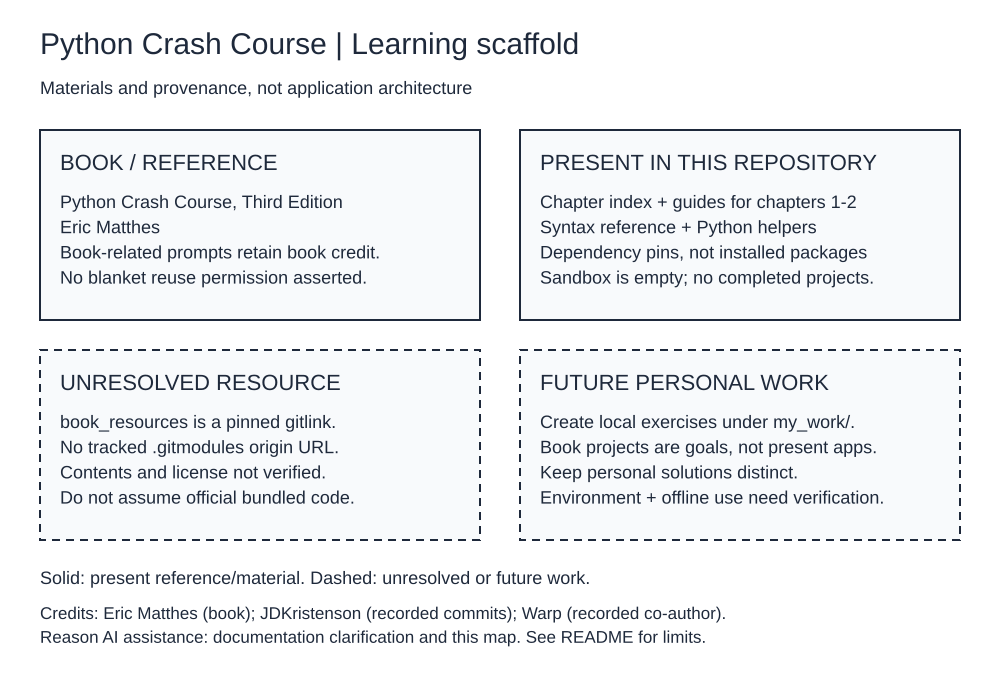

# Python Crash Course Companion

A partial learning scaffold for **_Python Crash Course, Third Edition_ by Eric Matthes**. This repository contains chapter notes, a syntax reference and small Python helpers. It is not the book, a complete offline bundle, or a finished game, visualization or web application.

## What a fresh clone contains

- [Chapter index](exercises/CHAPTERS_OVERVIEW.md), plus dedicated guides for [chapter 1](exercises/chapter_01_getting_started.md) and [chapter 2](exercises/chapter_02_variables_and_data_types.md). Later chapters are topics in the index, not completed guides.
- [Python basics cheat sheet](quick_reference/python_basics_cheatsheet.md).
- [Activation helper](activate_env.sh), [legacy setup diagnostic](verify_setup.py), and [experiment sandbox](quick_test.py). The sandbox's `test_code()` body is currently `pass`; it is not a test suite or evidence of completed exercises.
- [Pinned dependency list](requirements.txt). Packages and a virtual environment are **not** included.
- `book_resources`: a Git **gitlink**, pinned at `fa709a0b729b7d8ca5e2880c074b68e971db2fda` in the source snapshot. No `.gitmodules` URL is tracked, so a fresh clone does not supply inspectable book resources. Do not assume recursive submodule initialization can restore them.
- Tool guidance in [CLAUDE.md](CLAUDE.md) and [WARP.md](WARP.md).

There are no tracked student solutions, `my_work/` workspace, Django `manage.py`, game entry point or application build configuration. The book's Alien Invasion, data visualization and Learning Log projects are **future learning goals**, not implemented features here.

## Setup from a fresh clone

The following commands are an inferred local workflow, **not a verified installation recipe**. Run them from the repository root on a system with Python and `venv` support. Python 3.12 is a suggested starting point for the recent pinned dependencies; the legacy diagnostic's Python 3.7 message is not a compatibility guarantee. Interpreter/platform compatibility and dependency installation have not been tested for this documentation update.

For the existing notes and basic Python experiments, no third-party packages are required:

```bash
python3 -m venv venv
source venv/bin/activate
# Alternatively, after creating venv: source activate_env.sh
mkdir -p my_work/part_1_basics/chapters/chapter_01
```

On Windows PowerShell, activate with `venv\Scripts\Activate.ps1` instead of the Bash `source` command. Create your own exercise files in a local chapter directory before running them.

For later book projects, the existing pins include Pygame, Matplotlib, Plotly, Django, Requests, Beautiful Soup and pytest with dependencies. Installation is optional for the basic notes and normally needs network access:

```bash
python -m pip install -r requirements.txt
```

No repository build step or application start command exists yet. Do not run Django or game commands until you have actually created the corresponding project.

### Checks and their limits

These are available commands to run locally, **not checks run for this documentation update**:

```bash
python quick_test.py       # Executes the sandbox; currently does no exercise work
python verify_setup.py     # Legacy informational diagnostic; see limitations below
```

`verify_setup.py` is not a reliable pass/fail gate: it ignores package-check return values, checks directory existence rather than book-resource contents, uses an outdated Python-version check, and does not set a failure exit status. A missing `my_work/` or `venv/` is expected before local setup. Even a success message does not prove offline readiness. No runtime behavior is changed by this documentation update.

When you have written actual tests, run `python -m pytest path/to/your_test_file.py` with pytest installed. No dedicated exercise test suite is currently tracked.

## Learning workflow and offline preparation

1. Read the relevant chapter in your own copy of Eric Matthes's book.
2. Use the two existing guides and syntax reference as supplementary material.
3. Create your own solutions under `my_work/`; name files by exercise and distinguish personal work from quoted or adapted book material.
4. Run the files and tests you create. Record what you implemented and checked before presenting it as portfolio work.
5. Consult book resources only after independently obtaining and verifying their source and applicable terms. The unresolved gitlink is not a working reference bundle.

Offline study requires advance preparation: a working local interpreter, any needed packages, the book and lawfully obtained reference files, plus a rehearsal with networking unavailable. None of that is guaranteed by cloning this repository. Network-dependent exercises need separate data or an online session.

## Provenance, credits and license status

- **Book:** _Python Crash Course, Third Edition_, **Eric Matthes**. The chapter organization and numbered “Try It Yourself” prompts relate to that book; they are not presented as original portfolio exercises authored by this repository. Exact derivation and redistribution permissions of those prompts have not been independently verified.
- **Repository history:** the two commits through [source snapshot `40c9232`](https://github.com/JDKristenson/python-crash-course-companion/commit/40c9232892323186b505f941fb3e10bbfa1990af) record **JDKristenson** as author/committer. The initial scaffold is dated 2025-11-07; the tool-guidance update is dated 2025-12-24. Commit identity and repository namespace do not establish ownership or original authorship of every file.
- **AI assistance:** the 2025-12-24 commit explicitly records **Warp** as co-author. Preserve that history. The presence of `CLAUDE.md` documents tool guidance, not proof that Claude authored the repository. This README clarification and the new learning-map documentation were prepared with **Reason AI assistance**.
- **Upstream resources:** the gitlink's origin and resource license are unresolved; no upstream URL is asserted here.
- **License status:** no top-level `LICENSE`, `COPYING` or `NOTICE` file was present in the inspected source snapshot. No blanket reuse permission is claimed. Book material, third-party resources and dependencies can have separate rights and terms. Verify permission before copying, redistributing or applying a repository-wide license.

Keep personal notes, local paths, account details and credentials out of shared exercises and screenshots.

## Editable learning map



[Editable Excalidraw source](docs/learning-map.excalidraw) · [Preview and editing notes](docs/README.md)

The map describes learning materials and their boundaries, **not runtime application architecture**. Solid boxes are present material; dashed boxes identify unresolved resources or future work.
